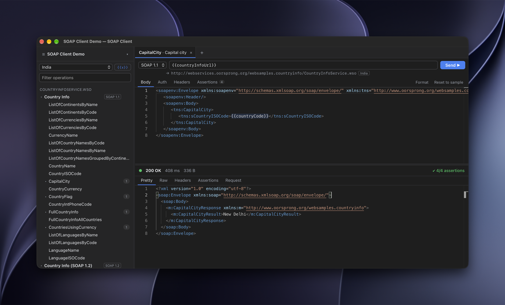
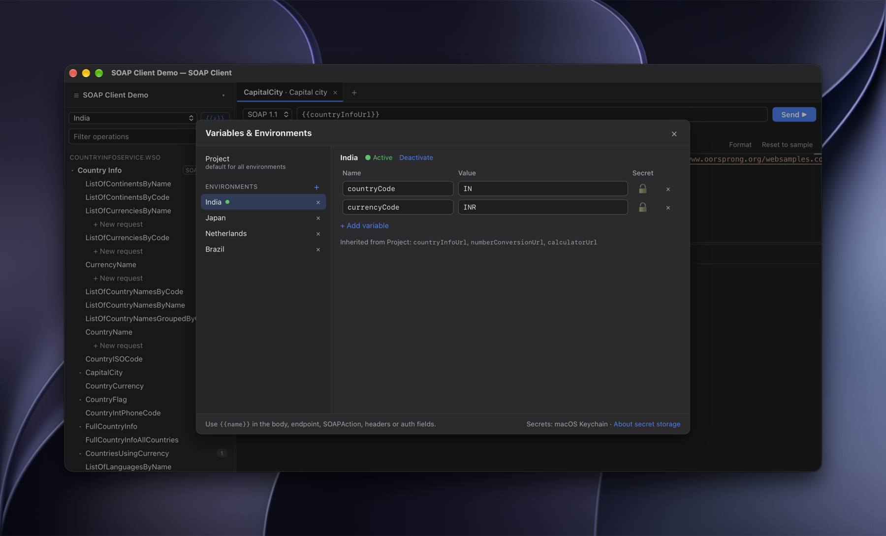
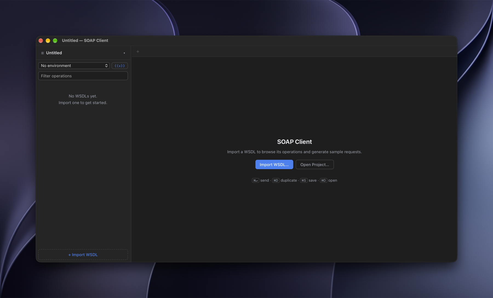

# SOAP Client

A lightweight, SoapUI-style desktop client for SOAP web services, for macOS and Linux.
Built with Rust, Tauri 2 and Svelte 5.



## Download and install

### macOS

Requires macOS 11 or later, on Apple Silicon or Intel.

1. Download the latest `.dmg` from the [Releases page](https://github.com/yedhukrishnan/soap-client/releases/latest).
2. Open it and drag **SOAP Client** into **Applications**.
3. Open SOAP Client from Applications or Spotlight.

The app is signed and notarized by Apple, so it opens without security warnings. Saved secrets are
protected by Touch ID (or your Mac password): macOS asks the first time a request uses a secret, and
again after 15 minutes without using secrets.

To check the download, compare its checksum with `SHA256SUMS.txt` on the release page:

```sh
shasum -a 256 ~/Downloads/SOAP-Client-*-macOS-universal.dmg
```

**Updating:** download the new version and replace the app in Applications. Your projects,
environments and saved secrets are kept.

**Uninstalling:** delete the app, and optionally its data: the folder
`~/Library/Application Support/dev.soapclient.app` and, in Keychain Access, the entries named
`dev.soapclient.app`.

### Linux

There are no prebuilt Linux packages yet. You can [build from source](#building), which produces
`.deb`, `.rpm` and AppImage packages.

## Features

- **WSDL import** from a URL or file. Imported WSDLs and schemas (`wsdl:import`, `xsd:import`,
  `xsd:include`, `xsd:redefine`) are loaded too and stored in the project, so it works offline.
- **Sample requests** generated from the schemas, SoapUI-style: optional and repeated elements,
  choices, enumerations, attributes and type extensions.
- **SOAP 1.1 and 1.2**, document/literal and rpc/literal, `soap:header` parts.
- **Request editor** with tabs, an XML editor, and pretty, raw, header and sent-request views of the response.
- **Authentication**: HTTP Basic and WS-Security UsernameToken (text or digest password, optional
  timestamp), plus custom HTTP headers.
- **Assertions**: HTTP status, body contains / does not contain, XPath 1.0 match, no SOAP Fault and
  maximum response time.
- **Variables and environments**: use `{{name}}` in the body, endpoint, SOAPAction, headers or auth
  fields. Environments (for example, one per supplier) override project defaults and can hold
  their own endpoint URLs; switch between them from the sidebar.
- **Secrets** are stored in the macOS Keychain or the Linux system keyring, never in project files,
  and are masked in the sent-request view. Passwords typed literally into a request are detected,
  with a one-click *Move to secret variable*.
- **Autosave**: your work is saved continuously and restored on the next launch.
  Projects can also be saved as `.json` files to share.

### Screenshots

**Variables and environments.** Switch between environments (here, one per country) and the same
requests use their values.



**Responses.** Pretty-printed XML with status, timing and size, plus raw, header and sent-request views.


**Getting started.** Import a WSDL from a URL or file, or open a saved project.



### Keyboard shortcuts

| Action | macOS | Linux |
|---|---|---|
| Send request | ⌘↵ | Ctrl+Enter |
| Duplicate request | ⌘D | Ctrl+D |
| Save / Save as | ⌘S / ⇧⌘S | Ctrl+S / Ctrl+Shift+S |
| Open project | ⌘O | Ctrl+O |

## Development

Prerequisites: Rust (stable) and Node.js 20.19+ or 22.12+.
On Linux, also install the WebKitGTK toolchain, e.g. on Debian/Ubuntu:

```sh
sudo apt install libwebkit2gtk-4.1-dev libgtk-3-dev libayatana-appindicator3-dev librsvg2-dev build-essential
```

```sh
npm install
npm run tauri dev        # run the app with hot reload
npm run check            # type-check the frontend
cargo test               # Rust tests
cargo test -- --ignored  # also: live call to dneonline.com, and a test against the real OS keychain
```

### Project layout

```
crates/soap-core   SOAP logic: WSDL/XSD parsing, sample generation, envelopes and WS-Security,
                   HTTP, variables, assertions, project and session files. No UI dependencies.
src-tauri          Desktop shell: Tauri commands, menu, secret storage
ui                 Svelte 5 + TypeScript frontend
```

## Building

```sh
npm run tauri build   # unsigned build: .app and .dmg (macOS) or .deb, .rpm and AppImage (Linux)
npm run build:mac     # macOS, code-signed
```

Builds are written to `target/release/bundle/`.

### Code signing on macOS

A signed build keeps the same identity across rebuilds, so a Keychain *Always Allow* stays in effect.
`npm run build:mac` reads the signing identity from `src-tauri/tauri.signing.json` (git-ignored):

```json
{ "bundle": { "macOS": { "signingIdentity": "<identity name or SHA-1>" } } }
```

List available identities with `security find-identity -v -p codesigning`. An *Apple Development*
certificate works, as does a self-signed code-signing certificate created in Keychain Access.
Unsigned builds may ask for Keychain access again after every rebuild. Touch ID protection needs a
release build with the provisioning profile (see below); other builds use the login keychain.

### Releasing (macOS)

`npm run release:mac` builds a universal (Apple Silicon + Intel) app signed with a *Developer ID
Application* certificate, notarizes and staples both the app and the disk image, verifies them with
Gatekeeper, and writes `release/<version>/` with the `.dmg` and `SHA256SUMS.txt`.

It needs a Developer ID provisioning profile for `dev.soapclient.app` at
`~/.appstoreconnect/soap-client.provisionprofile` (it grants the keychain entitlement used for Touch ID),
and an App Store Connect API key (role *Developer*) stored outside the repo:
`~/.appstoreconnect/AuthKey_<KEYID>.p8` and its Issuer ID in `~/.appstoreconnect/issuer-id`
(or `APPLE_API_KEY_PATH`, `APPLE_API_KEY`, `APPLE_API_ISSUER` in the environment), plus
`rustup target add x86_64-apple-darwin`.

To publish a release:

1. Set the same version in `package.json`, `src-tauri/Cargo.toml` and `src-tauri/tauri.conf.json`, and commit.
2. Run `npm run release:mac`.
3. Tag and publish:

   ```sh
   git push origin main
   git tag v<version> && git push origin v<version>
   gh release create v<version> release/<version>/*.dmg release/<version>/SHA256SUMS.txt \
     --title "SOAP Client <version>" --notes-file <release-notes.md>
   ```

## Privacy and security

- **Your passwords stay in your Keychain.** Secret values are stored only in the macOS Keychain
  (protected by Touch ID) or the Linux system keyring, never in project files, and the app only uses
  its own entries (`dev.soapclient.app`).
- **Shared project files are safe to open.** If a project file would use secrets saved on your
  computer, the app asks first.
- **Imports stay where they belong.** A WSDL from the web only loads other web documents, and only
  schemas and WSDLs are imported.
- **Local data is private.** The interface runs under a strict Content Security Policy, and the
  autosaved session is readable only by your user.

To report a security concern, see [SECURITY.md](SECURITY.md). Bugs and ideas are welcome as
[issues](https://github.com/yedhukrishnan/soap-client/issues).

## Limitations

- WSDL 2.0, MTOM/attachments and WS-Addressing are not supported.
- Included schemas without a target namespace ("chameleon includes") are not remapped.
- Without a system keyring (some minimal Linux setups), secrets are kept only until the app quits.

## License

[MIT](LICENSE) © 2026 [Yedhu Krishnan](https://yedhu.me)
