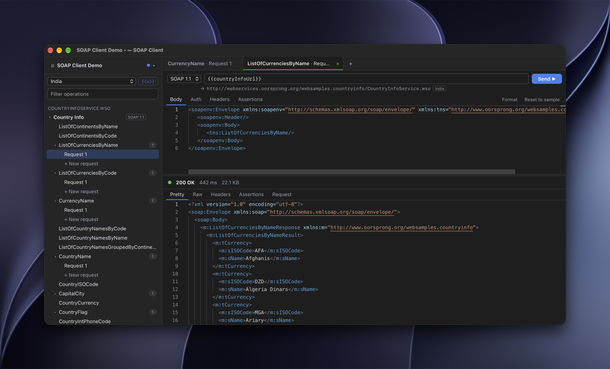

# SOAP Client

Small. Secure. Just SOAP. A clutter-free desktop client for testing SOAP web services, for macOS and Linux.


## Download

**macOS 11 or later** (Apple Silicon and Intel): download the latest `.dmg` from the
[Releases page](https://github.com/yedhukrishnan/soap-client/releases/latest), open it and drag
**SOAP Client** into **Applications**.

**Linux** (x86_64 and arm64): download from the same page.

- **Debian 12+ / Ubuntu 22.04+:** `sudo apt install ./soap-client_<version>_<arch>.deb`
- **Arch Linux:** `sudo pacman -U soap-client-bin-<version>-1-x86_64.pkg.tar.zst`

Secrets are kept in your keyring through the Secret Service API, so a keyring such as GNOME Keyring,
KWallet or KeePassXC must be running; without one they are kept only until the app quits.

## Features

- **Import a WSDL** from a link or a file, including the schemas it imports. Works offline afterwards.
- **Ready-made requests** for every operation, generated from the schemas. SOAP 1.1 and 1.2.
- **Environments and variables:** use `{{name}}` anywhere in a request and switch servers or credentials in one click.
- **Secrets stay private:** stored in the macOS Keychain (unlocked with Touch ID) or the Linux keyring, never in project files.
- **Checks on every send:** status, XPath, contains, no SOAP Fault and response time.
- **Authentication:** HTTP Basic and WS-Security UsernameToken, plus custom headers.
- **Autosave:** your work is restored when you reopen the app. Projects can be shared as `.json` files.

<p>
  
  
  
</p>

## Building from source

You need Rust and Node.js 20.19+ (or 22.12+). On Linux, also install WebKitGTK
(on Debian/Ubuntu: `libwebkit2gtk-4.1-dev libgtk-3-dev librsvg2-dev libdbus-1-dev build-essential`;
on Arch: `webkit2gtk-4.1 base-devel`).

```sh
npm install
npm run tauri dev     # run the app
npm run tauri build   # build packages into target/release/bundle/
cargo test            # run the tests
```

Maintainers: see [docs/RELEASING.md](docs/RELEASING.md) for macOS and Linux releases.

## Privacy and security

Secrets never leave your Keychain except to be sent to your own endpoints, shared project files can't
use your saved secrets without asking, and WSDLs from the web can't read local files.
To report a security concern, see [SECURITY.md](SECURITY.md).

## License

[MIT](LICENSE) © 2026 [Yedhu Krishnan](https://yedhu.me)
